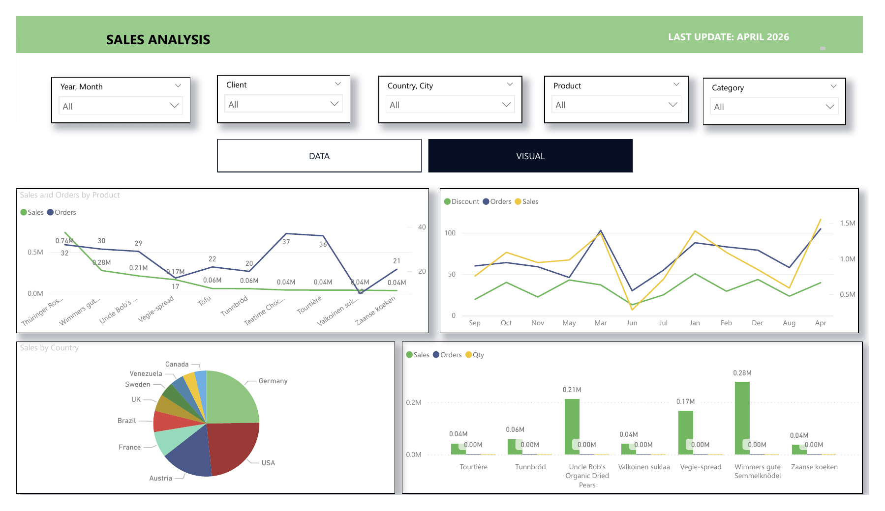
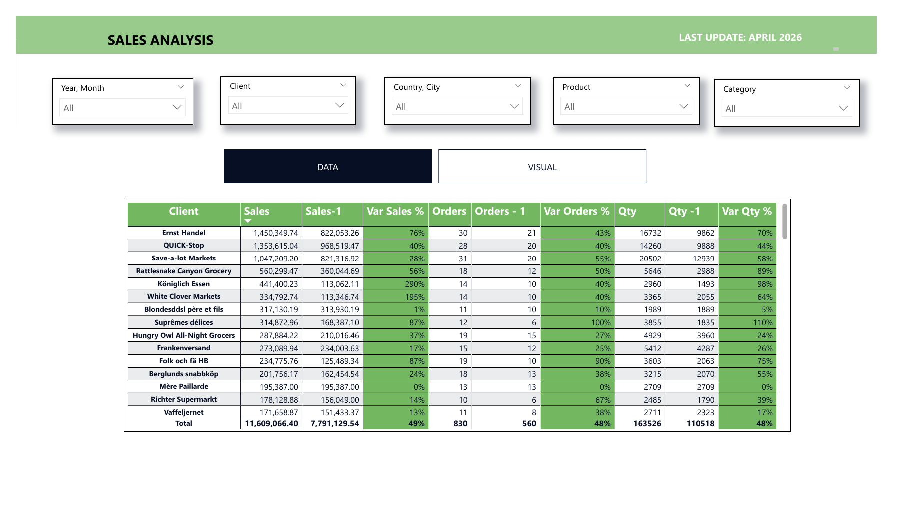

# Sales & Customer Performance Dashboard (Power BI + SQL)

A two-page Power BI report that tracks sales, orders and quantities by client, product, category and country, with year-on-year comparison and slicers for period, client, location and product.

## Business question
Which clients, products and countries drive revenue growth, and where is performance slipping?

## Data and model
- Source: the Northwind sample sales database (orders, customers, products, categories, employees).
- Star schema with a `Sales` fact table linked to `Customers`, `Products`, `Categories`, `Employees` and a `Calendar` date table (see `data_model.jpeg`).
- Calculated columns and DAX measures for sales after discount, cost per unit, days between order and delivery, delivery status and **% late deliveries**.
- Prior-period measures (Sales-1, Orders-1, Qty-1) and variance % for year-on-year comparison.

## Key insights
- Sales grew **49%** year on year (11.6M vs 7.8M), driven by order volume: orders **+48%** (830 vs 560) and quantity **+48%**.
- Revenue is concentrated: the top 3 clients (Ernst Handel, QUICK-Stop, Save-a-lot Markets) bring about **33%** of total sales.
- Ernst Handel is both the largest client (1.45M) and one of the fastest growing (**+76%**).
- Some smaller accounts more than doubled (Königlich Essen **+290%**, White Clover Markets **+195%**), which makes them candidates for key-account follow-up.
- Germany and the USA are the largest markets by sales.

## Report pages
| Page | What it shows |
|---|---|
| Data | Client table with sales, orders and quantity vs prior year and variance % |
| Visual | Sales and orders by product, monthly trend with discount, sales by country, top products |

## Files
- `sales_performance_analysis.pdf`: export of the full report
- `data_model.jpeg`: Power BI data model
- `dashboard_visual.png`, `dashboard_data.png`: report screenshots

## Tools
Power BI (Power Query, DAX, data modelling), SQL

## Author
Daniel Usuwa, Data & BI Analyst · [LinkedIn](https://linkedin.com/in/usuwa-daniel)
